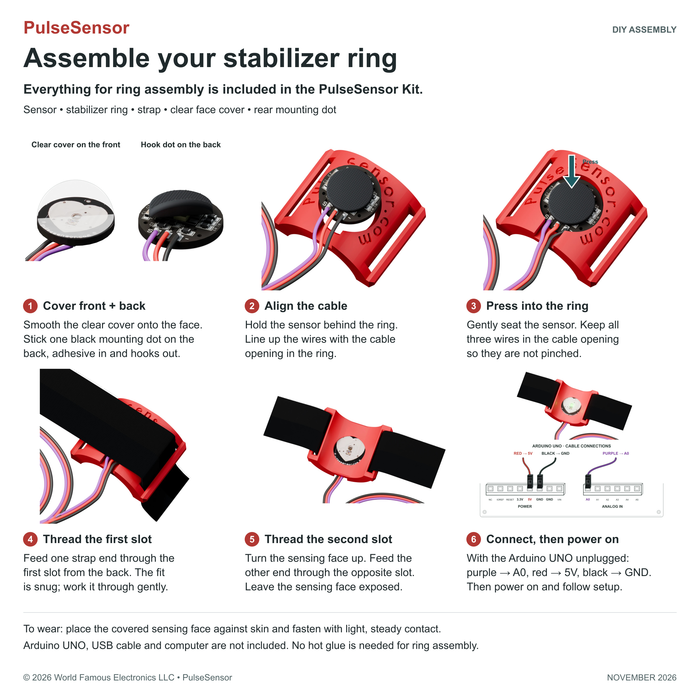
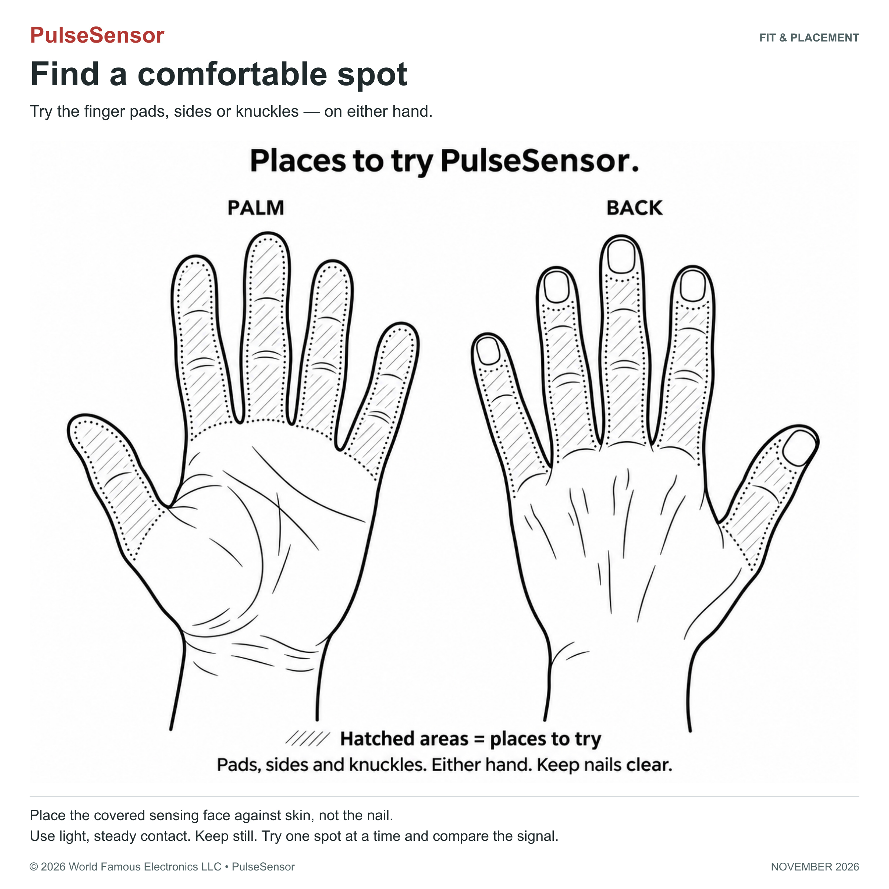
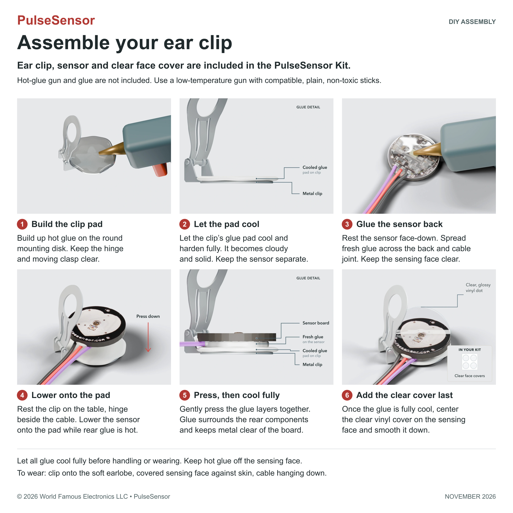
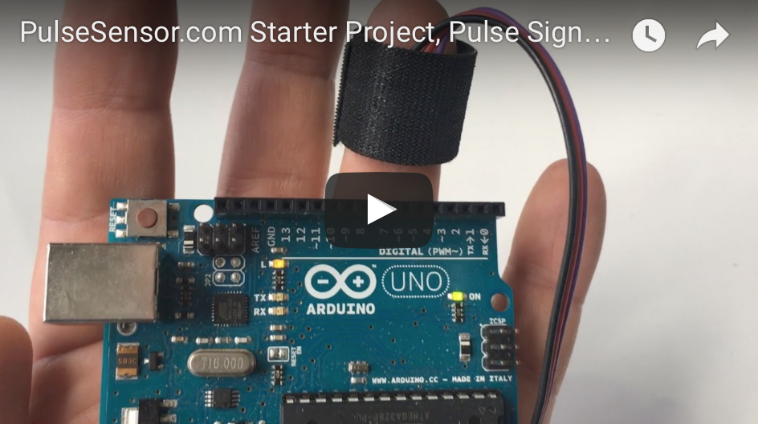
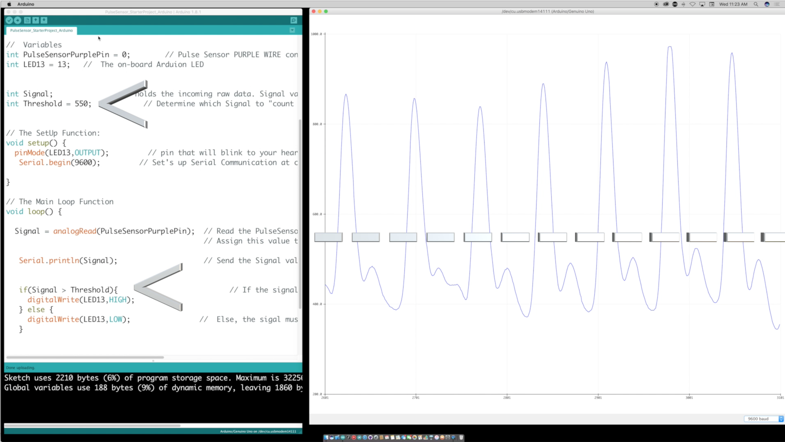
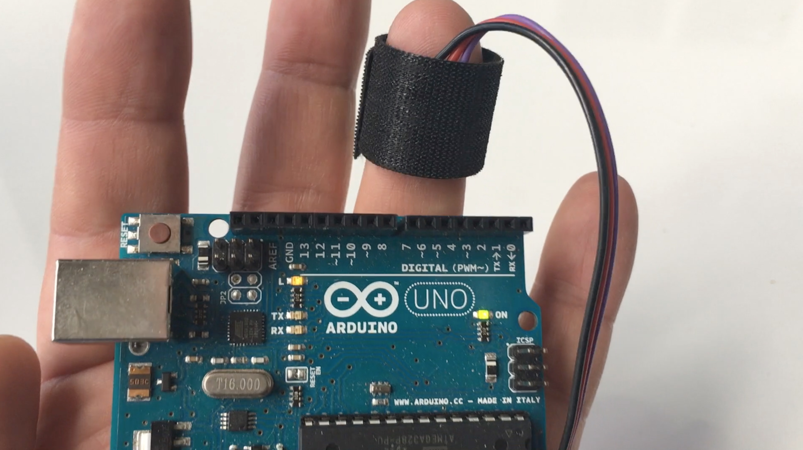
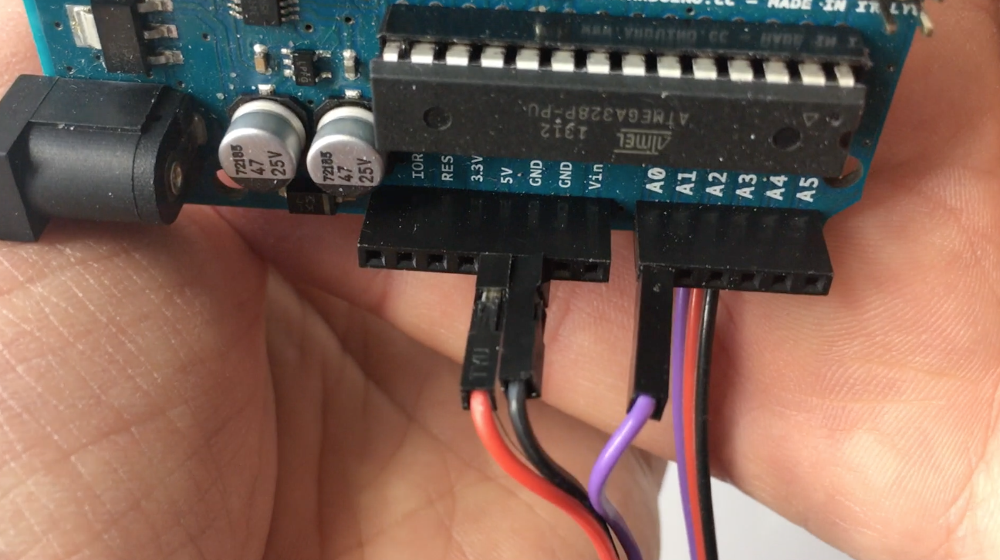

## Getting Started Code / <a href="http://www.pulsesensor.com">PulseSensor</a>  & <a href="http://arduino.cc/"> "Arduino"</a>

## Assemble your PulseSensor kit

Choose the **stabilizer ring** for finger placement or the **ear clip** for earlobe placement. Follow the preparation steps before putting the sensor against your skin.

[Ring assembly](#stabilizer-ring--no-glue-needed) · [Ear-clip assembly](#ear-clip--hot-glue-required) · [All assembly steps in text](docs/assembly/README.md)

### Stabilizer ring — no glue needed

Everything needed for ring assembly is included in the current PulseSensor Kit: sensor, stabilizer ring, strap, clear face cover, and rear mounting dot.

[Read the ring steps on GitHub](docs/assembly/README.md#stabilizer-ring) · [Full ring guide on PulseSensor.com](https://pulsesensor.com/pages/ring-prep)

### Find a comfortable spot on either hand

Try the pads, sides, or knuckles of your fingers on either hand. Place the covered sensing face against skin, not the nail. Use light, steady contact and keep your hand still. Try one spot at a time and compare the signal.

### Ear clip — hot glue required

The ear clip, sensor, and clear face cover are included in the kit. **A hot-glue gun and glue are required and are not included.** Use a low-temperature gun with compatible, plain, non-toxic glue sticks. Keep glue off the sensing face and let all glue cool fully before handling or wearing.

[Read the ear-clip steps on GitHub](docs/assembly/README.md#ear-clip) · [Full ear-clip guide on PulseSensor.com](https://pulsesensor.com/pages/earclip-prep)

A compatible development board, USB data cable, and computer are not included in the kit. The wiring shown is for an **Arduino UNO**; use the correct analog pin and voltage for other boards. Click either instruction image to view it at full size.

Assembly guides © 2026 World Famous Electronics LLC · PulseSensor. Updated November 2026.

---

* Newbie-friendly code.   
* Live visualization of Raw Pulse Signal in Arduino's cool "Serial Plotter".

* Blink an LED (on Pin 13) with your heartbeat!  💓

* A great first-step in troubleshooting your circuit, connections, and project!

------------------------------------------------------
#####  Legal:  PulseSensor.com™ World Famous Electronics llc. in Brooklyn, NY. USA
------------------------------------------------------
Made Something Awesome With the PulseSensor Code?   Send Us Some PayPal Love. ♥︎  
 
